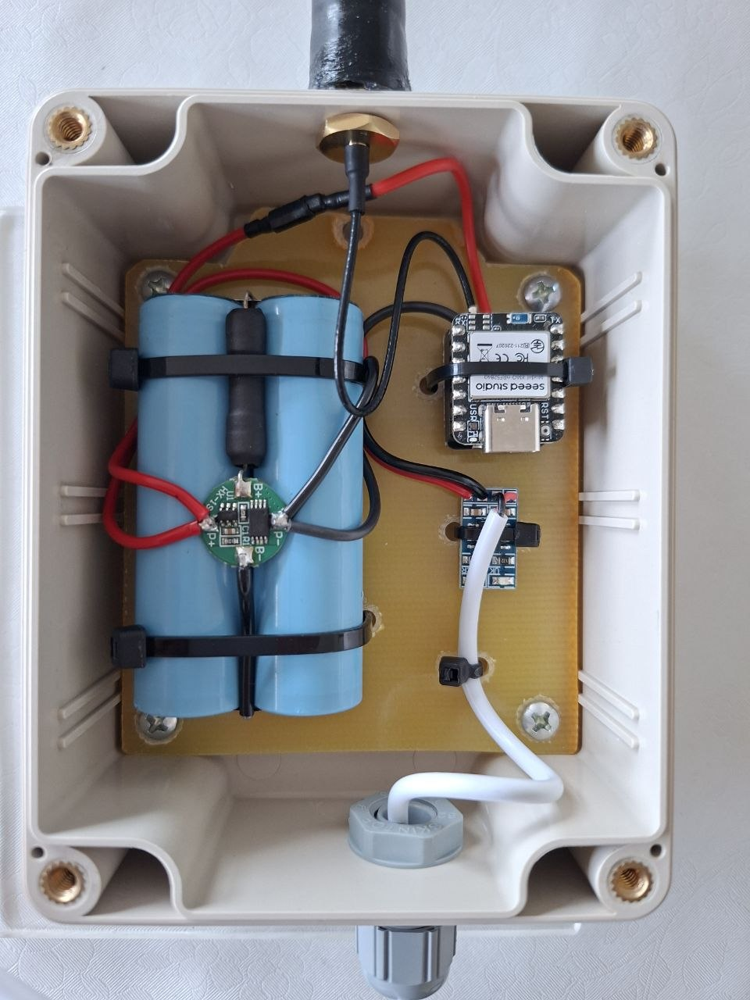

# MeshCore u CroMeshu

CroMesh je zajednica koja razvija i Meshtastic i MeshCore mrežu. Obje se razvijaju
**paralelno** i nijedna nije obvezna. Prednosti pojedinog protokola ovise o načinu
korištenja.

## Što je MeshCore?

MeshCore je lagan sustav za sigurnu tekstualnu komunikaciju putem LoRa radija na
868 MHz. Svaki node u Hrvatskoj može biti dio mreže, a repetitori prosljeđuju poruke
dalje — bez centralnog operatera i bez internetske veze.

Poput Meshtastica, MeshCore omogućuje autonomnu komunikaciju između node-ova. MeshCore
mreža trenutačno se razvija i gradi na području Republike Hrvatske.

Sudjelovanje nije vezano uz jedan protokol: korisnici mogu odabrati Meshtastic ili
MeshCore prema vlastitim potrebama i preferencijama, a moguće je koristiti oba protokola
na neovisnim uređajima.

## Razlika između Meshtastic-a i MeshCore-a

Najveća razlika je u načinu usmjeravanja poruka.

**Meshtastic** koristi tzv. "managed flood" routing — svaki uređaj u ulozi Client prima
i prosljeđuje tuđe poruke. To mrežu čini jednostavnom za postavljanje i vrlo otpornom,
ali može povećati zauzeće radio-kanala u gušćim mrežama.

**MeshCore** razdvaja uređaje po ulogama: obični uređaji (Companion) ne prosljeđuju tuđe
poruke, već to rade isključivo namjenski postavljeni repetitori. Rezultat je tiša i
predvidljivija mreža, ali uz potrebu za pažljivijim planiranjem pokrivenosti repetitorima.

Oba protokola su otvorenog koda i mogu raditi na istom LoRa hardveru, ali
**međusobno nisu kompatibilna**.

## Kratki pregled razlika

| | Meshtastic | MeshCore |
|---|---|---|
| Usmjeravanje | Flooding, uz ograničenje hopova (zadano 3) | Prvi put flood, zatim se pamti put |
| Repetitori | Prosljeđuju poruke po pravilima flood-a | Prosljeđuju samo ako su na putu poruke |
| MQTT | Uplink na kartu i nadzor | Nema ugrađenog MQTT-a (mreža radi bez interneta); observeri mogu slati pakete na MQTT, vidi [Povezivanje i observeri](postavke.md#povezivanje-mreze-i-observeri) |
| Hardver | Isti moduli (npr. XIAO nRF52 + Wio-SX1262, Heltec V4) | Isti moduli, drugi firmware |

> **Napomena:** Zajednica nije jedinstvena u ocjeni koji je protokol "bolji". Dio članova
> izvještava o znatno boljoj isporuci poruka na MeshCoreu u gustim mrežama (npr. Osijek),
> a dio navodi prednosti Meshtastica u izvanrednim situacijama i veću zajednicu.
> Dokumentacija ostaje neutralna.

## Što se nalazi u ovom tabu

- **[Postavke](postavke.md)** — preporučene postavke za CroMesh i imenovanje repetitora,
  [usmjeravanje poruka](postavke.md#usmjeravanje-poruka-u-meshcoreu),
  [povezivanje mreže i observeri](postavke.md#povezivanje-mreze-i-observeri) te
  [poznati problemi](postavke.md#poznati-problemi)
- **[Meshtastic i MeshCore](meshtastic-i-meshcore.md)** — rad oba protokola na istom
  uređaju i (ne)mogućnost međusobne komunikacije
- **[Poveznice i pravna napomena](poveznice.md)** — MeshCore HR, karte, alati, licenca

Poznati MeshCore repetitori u Hrvatskoj navedeni su na stranici
[Infrastruktura](../mreza/infrastruktura.md).

> Pravna napomena o neovisnosti, žigu i licenci nalazi se na stranici
> [Poveznice i pravna napomena](poveznice.md#napomena-o-neovisnosti-zigu-i-licenci).

## Poveznice

**Službeni izvori**

- [meshcore.io](https://meshcore.io) — službena stranica projekta
- [MeshCore dokumentacija](https://docs.meshcore.io/) — službena dokumentacija
- [FAQ](https://docs.meshcore.io/faq/) — usmjeravanje, repetitori, veličina path hasha
- [CLI naredbe](https://docs.meshcore.io/cli_commands/) — `loop.detect`, `path.hash.mode`, `set radio`
- [Radio presetovi](https://docs.meshcore.io/radio_presets/)
- [MeshCore na GitHubu](https://github.com/meshcore-dev/MeshCore) — izvorni kod i prijave grešaka

**Hrvatska zajednica i alati**

- [MeshCore HR](https://meshcore.com.hr/) — vodič, karta i observeri za Zagreb i okolicu
- [MeshCore HR karta](https://map.meshcore.com.hr/)
- [MeshCore karta (globalno)](https://map.meshcore.io)
- [LetsMesh Analyzer](https://analyzer.letsmesh.net)

Potpuni popis s opisima: [Poveznice i pravna napomena](poveznice.md).

<figure class="cromesh-doc-photo">
  
</figure>

---

!!! info "Napomena o neovisnosti"
    docs.cromesh.eu je neovisan projekt i nije povezan s tvrtkom MeshCore Technologies
    Limited niti službenim MeshCore timom; „MeshCore” je naziv njegovih vlasnika. Sadržaj
    se pruža „kakav jest”, bez jamstva, a mjerodavna je službena dokumentacija na
    [docs.meshcore.io](https://docs.meshcore.io/). Cjelovita
    [pravna napomena](poveznice.md#napomena-o-neovisnosti-zigu-i-licenci).
