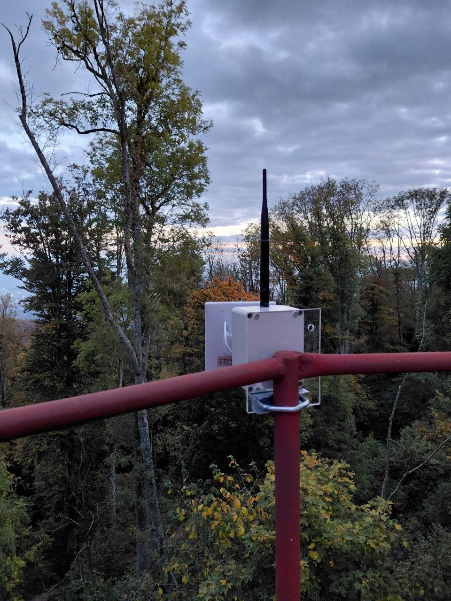

# Meshtastic i MeshCore zajedno

## Mogu li isti uređaj i ista antena koristiti oba protokola istodobno?

**Ne.** Protokoli rade s različitim LoRa parametrima (bandwidth, spreading factor,
coding rate), a radio ne može istodobno slušati dvije konfiguracije. Postoje:

- **Dual-boot firmware** za Heltec V4 (prebacivanje na pokretanju, ne istodobno),
- **dva odvojena modula u istom kućištu** (npr. 2 × XIAO nRF52 + Wio-SX1262 s jednim
  solarom i baterijom).

Dijeljenje jedne antene preko razdjelnika nije praktično jer su frekvencije preblizu.

**Preporuka:** kanali Meshtastica i MeshCorea se preklapaju, pa je između dvije antene
potrebna visinska razlika od najmanje **1,5 m**.

## Mogu li MeshCore i Meshtastic međusobno razgovarati?

**Ne izravno.** Kompatibilni su na fizičkom sloju (LoRa), ali ne na razini protokola.
Oba protokola su otvorenog koda i mogu raditi na istom LoRa hardveru, ali međusobno nisu
kompatibilna. Neka mjesta u mreži imaju dvostruke nodove (dva noda, na svakom po jedan sustav:
Meshtastic i MeshCore) — vidi
[Infrastruktura](../mreza/infrastruktura.md#slavonija-i-podravina).

Pregled razlika: [MeshCore u CroMeshu](index.md).

<figure class="cromesh-doc-photo">
  
</figure>

---

!!! info "Napomena o neovisnosti"
    docs.cromesh.eu je neovisan projekt i nije povezan s tvrtkom MeshCore Technologies
    Limited niti službenim MeshCore timom; „MeshCore” je naziv njegovih vlasnika. Sadržaj
    se pruža „kakav jest”, bez jamstva, a mjerodavna je službena dokumentacija na
    [docs.meshcore.io](https://docs.meshcore.io/). Cjelovita
    [pravna napomena](poveznice.md#napomena-o-neovisnosti-zigu-i-licenci).
