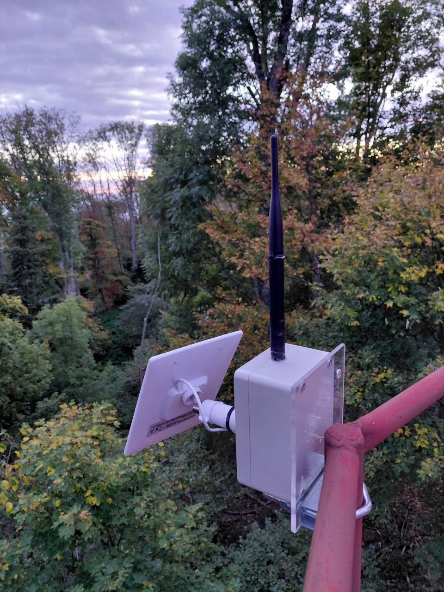
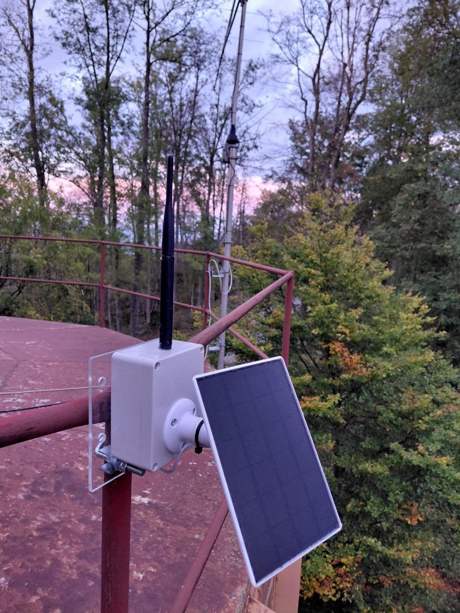

# MeshCore postavke za CroMesh

## Preporučene postavke za CroMesh

- Radio preset: **EU/UK (Narrow)** — 869,618 MHz, SF8, BW 62,5 kHz, CR 8 (prema popisu
  presetova koji koristi MeshCore aplikacija; službeni popis je na
  [stranici Radio Presets](https://docs.meshcore.io/radio_presets/), a preseti su
  prijedlozi zajednice, ne obveza). Stariji preset „EU/UK (Deprecated)” (869,525 MHz,
  SF11, BW 250 kHz, CR 5) više se ne preporučuje.
- Coding rate: **CR 8** (provjeriti na repetitoru); službeni primjer naredbe
  `set radio` ima zadani CR 5, a dopušten raspon je 5–8.
- Širina path hasha: u zajednici se preporučuje **2 bajta** jer 1 bajt ima samo 256
  mogućih vrijednosti (2 bajta imaju 65 536), pa su kod 1 bajta moguće kolizije. Klijent s 2 bajta može komunicirati s klijentom s
  1 bajtom.
- Firmware repetitora: **1.14 ili noviji**. Stariji od 1.14 ne razumiju multi-bajt path
  hash i ispuštaju 2- i 3-bajtne pakete.
- Naredba `set path.hash.mode` određuje samo veličinu path hasha vlastitih *advert*
  paketa i ne znači da repetitor prosljeđuje samo taj format.
- Preporuka jednog člana: na repetitorima uključiti `set loop.detect moderate` kako se
  ista poruka ne bi ponovno prosljeđivala.

### Detekcija petlji (`loop.detect`)

Prema [MeshCore CLI dokumentaciji](https://docs.meshcore.io/cli_commands/) naredba
`set loop.detect <stanje>` prihvaća `off`, `minimal`, `moderate` i `strict`. Zadano je
`off`, a značajka je dodana u firmwareu **1.14**. „Dropanje” znači da repetitor **odbija**
(ne prosljeđuje dalje) flood pakete koji izgledaju kao da su u petlji, odnosno u čijem se
putu hash/ID tog repetitora pojavljuje previše puta:

| Stanje | 1-bajtni hash | 2-bajtni hash | 3-bajtni hash |
|---|---|---|---|
| `off` | bez detekcije | bez detekcije | bez detekcije |
| `minimal` | 4 ili više puta | 2 ili više puta | 1 ili više puta |
| `moderate` | 2 ili više puta | 1 ili više puta | 1 ili više puta |
| `strict` | 1 ili više puta | 1 ili više puta | 1 ili više puta |

### Veličina path hasha (`path.hash.mode`)

`set path.hash.mode <0–2>`: 0 = 1 bajt (zadano), 1 = 2 bajta, 2 = 3 bajta (vrijednost 3
je rezervirana i ne smije se koristiti). Prema dokumentaciji, postavka **ne utječe** na
veličinu hasha paketa koje taj repetitor prosljeđuje; također je dodana u firmwareu 1.14.

Veći hash znači više jedinstvenih ID-eva, ali manji maksimalni broj skokova (hopova)
flood paketa:

| Veličina hasha | Jedinstvenih ID-eva | Maks. flood hopova |
|---|---|---|
| 1 bajt | 256 | 64 |
| 2 bajta | 65 536 | 32 |
| 3 bajta | 16 777 216 | 21 |

Veličinu za poruke i advertove određuje pošiljatelj; u aplikaciji se podešava u
Eksperimentalnim postavkama (aplikacija 1.41.0 ili novija). Službeni FAQ savjetuje da
klijenti ostanu na 1 bajtu dok većina obližnjih repetitora ne prijeđe na 1.14+.

## Imenovanje repetitora

Dogovoreni obrazac za novi repetitor: `HR-<OZNAKA GRADA>-<lokacija>` (npr.
`HR-ZG-M.Sljeme`). Osijek koristi `HR OS ...`.

## Primjer: Base Sljeme

<figure class="cromesh-doc-photo">
  
</figure>

## Usmjeravanje poruka u MeshCoreu

### Način usmjeravanja (sažetak)

1. Prva poruka prema nekom kontaktu šalje se kao flood (kroz sve repetitore).
2. Pošiljatelj dobiva informaciju o putu kojim je poruka prošla najbrže i pohranjuje ga.
3. Sljedeće poruke koriste taj put, do tri pokušaja. Ostali repetitori ne sudjeluju.
4. Ako put ne radi, automatski se vraća na flood i ponovno traži novi put (prema službenom
   FAQ-u zadnji pokušaj se prema zadanim postavkama šalje kao flood; to se može isključiti
   u postavkama).
5. Put prema odredištu ne mora biti isti kao povratni, uključujući ACK.

**Repetitori ne usmjeravaju: rutu određuje node koji šalje.**

Grupni kanali nemaju definiran put pa se uvijek šalju flood-om; administrator repetitora
može ograničiti flood promet naredbom `set flood.max`. Klijenti (Companion) ne
prosljeđuju pakete; prosljeđuju samo repetitori te room serveri s uključenim
`set repeat on`. Ograničenje firmwarea je 64 skoka, no u praksi putevi rijetko dolaze
blizu toga.

### Usporedba s Meshtasticom

Meshtastic poruke šalje flood-om uz ograničenje hopova (zadano 3), a repetitori ih
prosljeđuju po pravilima flood-a. MeshCore nakon prvog flood-a pamti put, a repetitori
prosljeđuju poruku samo ako se nalaze na putu te poruke. Cjelovitu usporedbu vidi na
stranici [MeshCore u CroMeshu](index.md#kratki-pregled-razlika).

## Povezivanje mreže i observeri

### Spajanje udaljenih dijelova mreže

MeshCore mreža sama po sebi ne koristi MQTT. Za privremeno povezivanje dijelova mreže koristi se **Tailscale VPN
most** s XIAO ESP32-S3 koji se u mreži ponaša kao običan repetitor.

### Observer

Observer je repetitor spojen preko USB-a na Raspberry Pi koji šalje statistiku na web.
Preporuka: uređaj s WiFi-jem flashati kao observer kako bi mreža bila vidljiva 24/7.

#### Osnovno o postavljanju

Prema projektu [meshcoretomqtt](https://github.com/Cisien/meshcoretomqtt):

- Potrebno je računalo koje može pokretati Python 3.11+ (Raspberry Pi Zero, 2, 3 ili 4,
  ili drugi Linux/macOS uređaj) i repetitor spojen USB-om.
- Repetitor mora imati firmware izgrađen s uključenim bilježenjem paketa
  (`-D MESH_PACKET_LOGGING=1`) i jedinstveno ime. Testirane su RAK i Heltec ploče.
- Skripta čita repetitor preko serijskog porta (npr. `/dev/ttyACM0`) i objavljuje pakete
  (bez dešifriranja) na MQTT poslužitelje koje postaviš u konfiguraciji; najčešće se šalje
  na [LetsMesh](https://analyzer.letsmesh.net).
- Prijava na poslužitelj ide korisničkim imenom i lozinkom ili tokenom (token zahtijeva
  firmware 1.8.0 ili noviji).

Točne korake instalacije i konfiguracije vidi u README datoteci projekta.

### Koristan alat

Karte, vodiči i analizatori navedeni su na stranici
[Poveznice i pravna napomena](poveznice.md).

<figure class="cromesh-doc-photo">
  
</figure>

## Poznati problemi

### Kontakti su nestali iz aplikacije

Prijavljeno više puta, uzrok nije utvrđen (aplikacija ili node).

Što je poznato iz [MeshCore repozitorija](https://github.com/meshcore-dev/MeshCore/issues/1227):

- Lista kontakata ima ograničenje ovisno o uređaju (npr. 350). Kad se popuni, automatsko
  dodavanje staje i novi se kontakti pojavljuju samo na popisu otkrivenih, osim ako je
  uključeno prepisivanje najstarijih ("Overwrite Oldest").
- Jedan korisnik prijavio je da su mu nakon nadogradnje favoriti nestali nakon nekoliko
  dana na ograničenju; uzrok nije potvrđen.
- U CLI dokumentaciji ne postoji naredba za izvoz ili sigurnosnu kopiju kontakata. Privatni
  ključ (identitet noda) može se pročitati samo preko serijske konzole (`get prv.key`) i
  mora ostati tajan; to nije kopija kontakata.

### Slaba prolaznost u pokretu

U prvim testovima iz automobila u zagrebačkom urbanom području prolaznost MeshCorea
bila je mala. Za pouzdan rad u pokretu bit će potrebna veća gustoća repetitora — vidi
[Infrastruktura](../mreza/infrastruktura.md#zagreb-i-okolica).

### Povezano

- Popravak bootloadera XIAO nRF52 putem MeshCore web flashera:
  [Firmware](../firmware/index.md#poznati-problemi-pri-azuriranju).
- Opći problemi s uređajima i vezom: [Rješavanje problema](../rjesavanje-problema/index.md).

---

!!! info "Napomena o neovisnosti"
    docs.cromesh.eu je neovisan projekt i nije povezan s tvrtkom MeshCore Technologies
    Limited niti službenim MeshCore timom; „MeshCore” je naziv njegovih vlasnika. Sadržaj
    se pruža „kakav jest”, bez jamstva, a mjerodavna je službena dokumentacija na
    [docs.meshcore.io](https://docs.meshcore.io/). Cjelovita
    [pravna napomena](poveznice.md#napomena-o-neovisnosti-zigu-i-licenci).
