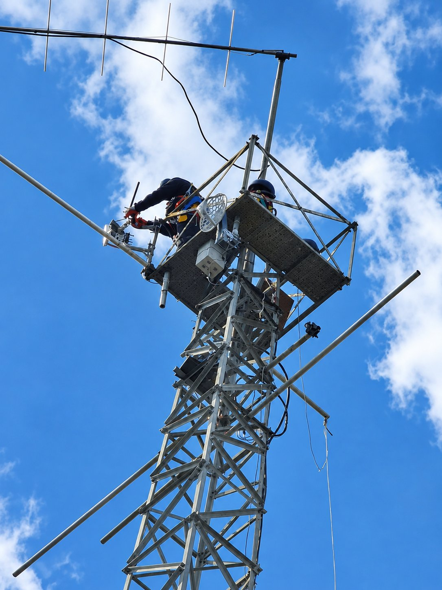

# Poznati fiksni routeri i repetitori

!!! note
    Popis je iz iskaza članova u grupi i nije službeni. Koordinate i status provjeriti na
    [map.cromesh.eu](https://map.cromesh.eu).

## Zagreb i okolica

Prvi izvještaji nakon postavljanja Meshtastic routera na Sljemenu: direktne veze s Donjom Dubravom,
Petrinjom i Samoborom te povremeno austrijski nodovi i slovenski nodovi.

Za MeshCore je u prvim testovima iz automobila u zagrebačkom urbanom području prolaznost
bila mala. Za pouzdan rad u pokretu bit će potrebna veća gustoća repetitora.

### Karlovac i Petrinja

Od starta u Meshtasticu, članovi radioklubova i amateri entuzijasti pridonose širenju mreže
planovima i projektima poput kupanjeiline.com i Kar0-Kar2. Petrinja je među prvijencima u
postavljanju konkretnog statičnog baznog node-a.

## Velebit i Jadran

Tri noda postavljena na Velebitu (među njima Budakovo Brdo). Prvotno su postavljeni za
potrebe speleološke ekspedicije, a konfigurirani su u ulozi routera pa sudjeluju u
cjelokupnoj mreži. Preko Budakovog Brda zabilježene su veze prema srednjoj Dalmaciji,
otocima, Istri (Pula) te izravne veze prema Italiji.

Zabilježene udaljenosti:

- oko 400 km najduža veza preko Velebita,
- Visoka (Split) – Dugi Rat oko 15 km, odnosno oko 50 km direktno s Medvednice
  prijenosnim uređajem T-Echo.

## Slavonija i Podravina

Osijek, Donji Miholjac i Slatina su primarno na MeshCoreu. Neka mjesta imaju dvostruke
nodove: dva noda, svaki sa svojim sustavom (jedan Meshtastic, jedan MeshCore). Detalji su na [map.meshcore.com.hr](https://map.meshcore.com.hr).

## Ostalo

Lokacije u izgradnji ili u testu: Krk, Rovinj, Pula, Karlovac, Varaždin.

## Lista nodova prisutna u TG grupi

Popis nodova prisutnih u Telegram grupi CroMesha dostupan je članovima u
[Telegram grupi](https://t.me/+LMnznzvgKCg2OTc0).

## Povezano

- Imenovanje routera i repetitora: [Uloge i imenovanje](uloge-i-imenovanje.md) i
  [MeshCore postavke](../meshcore/postavke.md#imenovanje-repetitora).
- Pregled MeshCore mreže: [MeshCore u CroMeshu](../meshcore/index.md).

<figure class="cromesh-doc-photo">
  
  <figcaption>KaR0</figcaption>
</figure>
