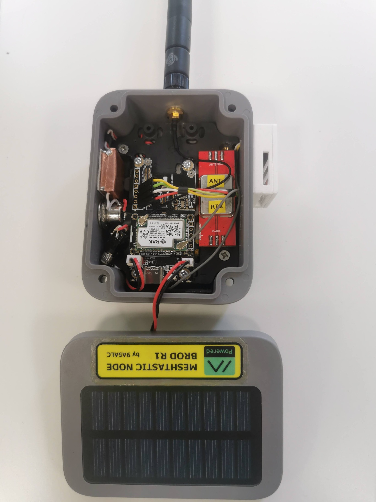

# Solarni uređaji

## Baterije

Standard zajednice za autonomne node-ove: **18650 Li-Ion ćelije** (jedna ili dvije u
paraleli).

| Preporučena ćelija | Kapacitet | Zašto |
|---|---|---|
| Sanyo UR18650ZM2 | 2420 mAh | Prošireni temperaturni raspon (−20 do +60 °C) — bitno za vanjske node-ove |
| Panasonic NCR18650B | 3400 mAh | Prošireni temperaturni raspon; veći kapacitet |

- Uzimaj ćelije s deklariranim proširenim temperaturnim rasponom (dostupne npr. na
  Conradu). Takve ćelije obično **nemaju ugrađenu zaštitu** — obavezno dodaj zasebnu
  **BMS/zaštitnu pločicu** (štiti od predubokog pražnjenja i prepunjavanja).
- Iskustvena potrošnja: 2× 18650 s uključenim power save (GPS/BT/WiFi isključeni)
  ≈ 10 % dnevno; RAK4631 s GNSS + BME280 ≈ 40–45 h na jednoj staroj 18650.

> **Upozorenje — punjenje ispod 0 °C:** Li-Ion baterije **ne smiju se puniti na
> temperaturama ispod nule** (trajno oštećenje ćelije). Za zimske uvjete opcije su:
> regulator s temperaturnim senzorom koji blokira punjenje, ili grijanje kućišta prije
> punjenja. LiFePO4 je alternativa, ali traži poseban punjač, a SoC očitanje je
> nepouzdano zbog ravne krivulje napona.

### Kemija baterija

- **Li-Ion:** standardno za ove uređaje.
- **LiFePO4:** nazivni napon oko 3,3 V je niži za oko 0,4 V, pa ugrađeni punjač na
  modulu ne radi ispravno, a indikator napunjenosti će biti netočan. Ako se koristi,
  treba vanjski punjač za LiFePO4. Preporuka: ne koristiti dok se ne testira donji napon
  na kojem node još radi.
- **NiMH (3S):** ne koristiti: elektronika je za Li-Ion i neće ispravno prikazivati
  napunjenost.
- Za Li-Ion u vanjskim uređajima na suncu i zimi članovi izvještavaju o godinama rada bez
  problema.

## Potrošnja

- **nRF52840 + SX1262** (npr. XIAO nRF52 + Wio-SX1262): vrlo štedljiv. Na jednoj bateriji
  18650 (2200 mAh) radi oko **tjedan dana**, a s dvije u paraleli oko 10 dana bez sunca
  (iskustvo člana).
- **ESP32-S3** (npr. Heltec V4): veća potrošnja, osobito s WiFi-jem. Pogodniji uz stalno
  napajanje.
- **Bluetooth** troši znatno manje energije od WiFi-ja (otprilike red veličine). Ipak, s
  jednom 18650 uz Bluetooth uređaj izdrži oko dan i noć.
- Veća snaga odašiljanja (npr. 27 dBm umjesto 22 dBm) znatno povećava potrošnju.

## Solarni regulatori

Preporučena arhitektura autonomnog node-a: **solarni panel → MPPT regulator → baterija
(s BMS-om) → node**. Odvojeni regulator (umjesto ugrađenog na ploči node-a) pokazao se
pouzdanijim — referentni node na Cepelišu s tom kombinacijom mjesecima ne pada ispod
95 % baterije.

| Komponenta | Detalji |
|---|---|
| **CN3791 MPPT modul** | ~2,6 €; verzije za 6 V / 9 V / 12 V panele — kupi verziju koja odgovara naponu panela; najkorišteniji regulator u zajednici |
| **Zaštita baterije (BMS pločica)** | Obavezna uz nezaštićene ćelije |
| **Jači solarni regulator** | Za routere: kvalitetnija varijanta ~25 €/kom (korištena na Cepelišu) |

> **Napomena:** Kod modula temeljenih na CN37xx zabilježeni su (neprovjereni) slučajevi
> "zablokiranja" nakon dubokog pražnjenja — regulator ne nastavi punjenje povratkom
> sunca. Ako node zimi "umre", prvo provjeri regulator. Uvjeti pod kojima se to događa
> još nisu potvrđeni ni dokumentirani od strane zajednice.

### Punjači i zaštita baterije

- **TP4056 i klonovi (npr. CL4056)** su općeniti Li-Ion punjači bez solarnih funkcija, pa ne
  izvlače maksimum iz panela. Punjači ugrađeni na pločama (npr. TP4054 na Heltec V3) imaju
  neprovjerenu zaštitu od prekomjernog pražnjenja.
- **CN3791** je pravi MPPT regulator, dok je CN3163 „MPPT” samo po imenu (smanjuje struju
  punjenja kako bi napon na ulazu ostao iznad oko 4,4 V). U jednom ispitivanju na forumu
  CN3791 je punio učinkovitije od RAK Green Power modula i ugrađenih punjača.
- Većina ćelija 18650 nema zaštitu od podnapona, pa je odvojena zaštitna pločica (BMS)
  potrebna i kad regulator štiti ulaz s panela.
- Neki jeftiniji moduli nisu se pouzdano oporavljali nakon potpunog pražnjenja baterije
  (zabilježeno za Hailege CN3065, a Waveshare D Solar Power Manager imao je problema sa
  zaštićenim ćelijama). Ako node zimi „umre”, prvo provjeri regulator.
- Zimi izlaz panela može biti znatno ispod nazivne snage (u jednom mjerenju panel od 4 W nije
  prelazio 1 W), pa panel treba predimenzionirati.

Izvori: [solarni LoRa node (kaspars.net)](https://kaspars.net/blog/solar-lora-meshtastic),
[Meshtastic forum: MPPT solarni node](https://meshtastic.discourse.group/t/universal-meshtastic-solar-node-with-mppt/14766).
Sheme spajanja nisu dodane.

### Provjerena kombinacija za solarni router

SeeedStudio XIAO nRF52 kit + solar SUPPSW001 (oko 25 € po komadu) + mali punjač solarnih
panela s AliExpressa + Li-ion baterije (npr. 2 × 18650 2200 mAh u paraleli).

- Jeftiniji Temu solar 5 V / 2,5 W (izmjereno oko 2,5 W) dovoljan je za osobni solarni
  node, a za router se preporučuje jači solar.
- Regulator s AliExpressa najčešće **nije pravi MPPT** (iako to piše), ali za 5 V solar
  razlika je mala. Bitno je da radi stabilno.
- Solar iz kućnih "solar" reflektora često ima ugrađenu elektroniku za USB. Treba je
  ukloniti i spojiti pravi regulator punjenja za Li-Ion.
- Sklopivi solarni punjači za mobitele nisu predviđeni za trajno postavljanje vani.

## Solarni paneli

- Za tipičan node dovoljan je panel od nekoliko W (5–10 W za router s rezervom);
  primjeri iz mreže: 12 V/10 W panel + CN3791 (12 V verzija), gotovi 868 solarni
  paneli s kućištem (~4 W) s AliExpressa, pa čak i TP-Link Tapo A200 panel (stabilna
  ~3 W).
- **RAK WisBlock base ploče imaju ugrađen solarni ulaz** — najjednostavnija integracija.
- Seeed XIAO kitovi nemaju solarni ulaz: solar ide preko vanjskog MPPT-a na bateriju,
  baterija s BMS-om na node. Upozorenje: potrošnja node-a tijekom punjenja zbunjuje
  regulator pri procjeni napunjenosti.
- Neke ploče s ugrađenim kontrolerom (npr. AXP192) po testovima ne pune iznad 4,15 V —
  to je normalno i produžuje život ćelije.

## Mrežno napajanje

Za fiksne node-ove na stalnom napajanju (ESP32 + WiFi kao MQTT gateway) sasvim je u redu
običan USB adapter; baterija tada nije nužna. PoE napajanje RAK WisBlocka spominjano je
u grupi, ali bez dokumentiranog rješenja za sada.

<figure class="cromesh-doc-photo">
  
</figure>
